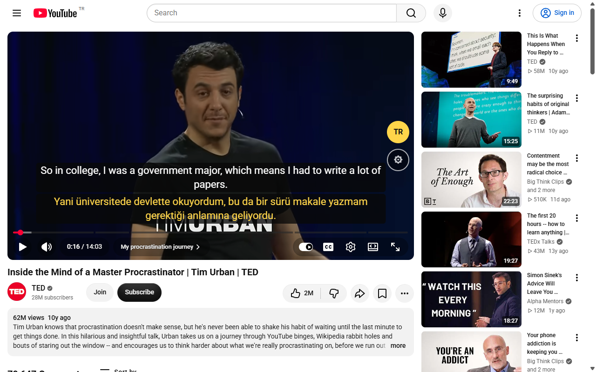
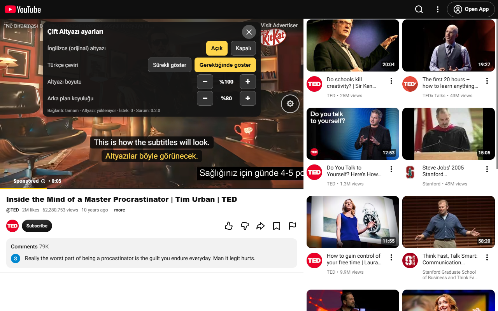
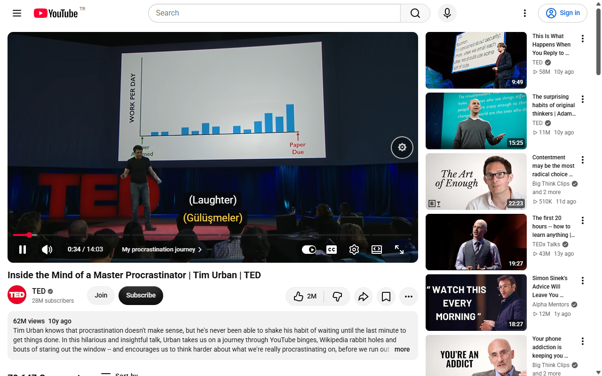
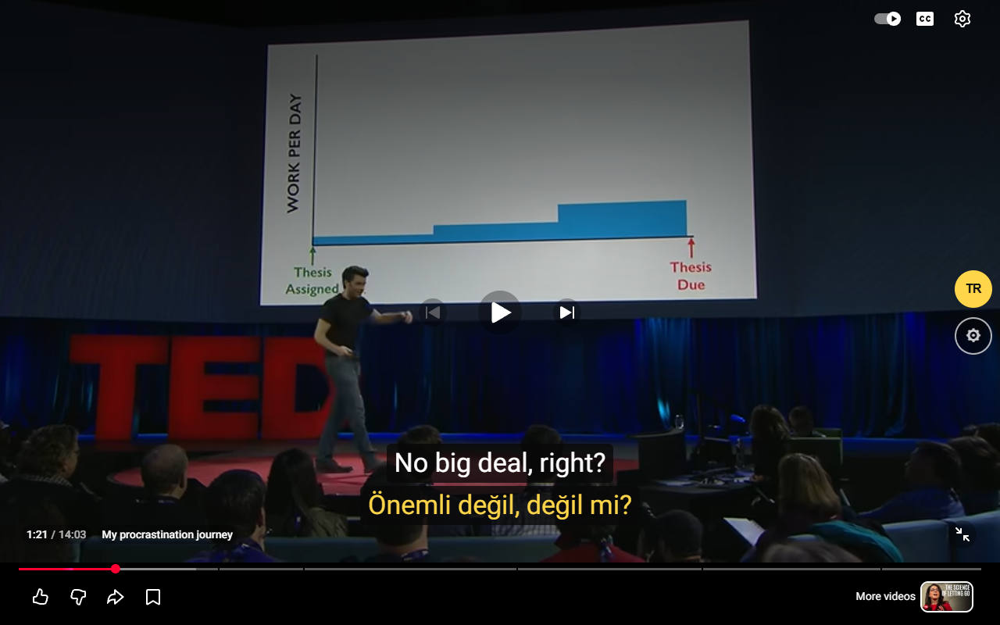

# Çift Altyazı — Kullanım Kılavuzu

Bu küçük program (betik), Android tabletinde YouTube izlerken:

- İngilizce altyazıyı **açıp kapatmanı**,
- Türkçe çeviriyi **sürekli** ya da **sadece istediğinde** görmeni sağlar.

Tamamen ücretsizdir. Hesap açman ya da para ödemen gerekmez.

---

## 1. Neler gerekiyor?

| Ne | Nereden | Neden |
| --- | --- | --- |
| **Firefox** tarayıcısı | Play Store | Android'de eklenti çalıştırabilen tarayıcı |
| **Violentmonkey** eklentisi | Firefox'un içinden | Bizim betiğimizi çalıştıran eklenti |
| **Çift Altyazı** betiği | Aşağıdaki link | Asıl işi yapan program |

> ⚠️ YouTube **uygulamasında** çalışmaz. Videoları **Firefox'ta** `youtube.com` adresinden izlemelisin.

---

## 2. Kurulum (bir kez yapılır, ~5 dakika)

### Adım 1 — Firefox'u kur
1. Tablette **Play Store**'u aç.
2. **Firefox** yaz. Yapımcısı **Mozilla** olanı seç.
3. **Yükle**'ye bas.

### Adım 2 — YouTube linkleri uygulamada açılmasın
1. Firefox'u aç → sağ üstteki (ya da alttaki) **⋮** (üç nokta) → **Ayarlar**.
2. **"Bağlantıları uygulamalarda aç"** seçeneğini bul (bazen **Gelişmiş** başlığının altındadır).
3. **Asla** olarak ayarla.

Böylece YouTube linkine dokununca YouTube uygulaması değil, Firefox açılır.

### Adım 3 — Violentmonkey'i kur
1. Firefox'un adres çubuğuna şunu yaz ve git:
   `addons.mozilla.org/firefox/addon/violentmonkey`
2. **"Firefox'a ekle"** düğmesine bas.
3. Çıkan pencerede **Ekle**'ye bas.

### Adım 4 — Çift Altyazı betiğini kur
1. Firefox'ta şu linki aç:
   **https://raw.githubusercontent.com/AhmedYasinKurt/cift-altyazi/main/cift-altyazi.user.js**
2. Violentmonkey'in kurulum sayfası açılır. **Yükle** (Install) düğmesine bas.
3. Sayfayı kapatabilirsin.

Kurulum bitti! 🎉

---

## 3. Kullanım

1. Firefox'ta `youtube.com`'a gir ve **altyazısı olan** İngilizce bir video aç.
2. Videoyu oynat. Birkaç saniye içinde video üzerinde **İngilizce altyazı** çıkar.
3. Videonun sağ kenarında iki yuvarlak tuş görürsün:

| Tuş | Ne yapar |
| --- | --- |
| **TR** | Video **durur** ve o cümlenin **Türkçesi** sarı renkte çıkar. Tekrar basınca Türkçe kaybolur, video **devam eder**. |
| **⚙** | Ayarlar panelini açar. |

> İpucu: TR'ye bastığında İngilizce satır da **cümlenin tamamını** gösterir. Böylece yarım kalan cümleler de anlaşılır olur.

### Ayarlar (⚙)

| Ayar | Seçenekler | Açıklama |
| --- | --- | --- |
| **İngilizce (orijinal) altyazı** | Açık / Kapalı | Videoda zaten yazı varsa ya da İngilizceye ihtiyacın yoksa **Kapalı** yap. |
| **Türkçe çeviri** | Sürekli göster / Gerektiğinde göster | **Sürekli**: her cümlenin altında Türkçesi hep görünür. **Gerektiğinde**: sadece TR tuşuna basınca çıkar. |
| **Altyazı boyutu** | `−` / `+` (%60 – %200) | Yazıyı küçültür / büyütür. Hem İngilizce hem Türkçe satıra uygulanır. |
| **Arka plan koyuluğu** | `−` / `+` (%0 – %100) | Yazının arkasındaki siyah kutunun koyuluğu. **%0** = kutu yok (yazıya gölge eklenir, video daha çok görünür); **%100** = tam siyah. |

Panel açıkken o an konuşma yoksa video üzerinde **örnek bir satır** görünür; boyutu ve koyuluğu değiştirirken sonucu hemen görürsün.

Seçimlerin kaydedilir. Tableti kapatıp açsan da aynı kalır.
İlk ayar: İngilizce **Açık**, Türkçe **Gerektiğinde göster**, boyut **%100**, koyuluk **%80**.

**Sürekli göster** modunda:

Tam ekranda da çalışır:

---

## 4. Sorun olursa

Önce **⚙** tuşuna bas. Panelin en altında küçük gri bir **durum satırı** var, örneğin:

`Bağlantı: tamam · Altyazı: 315 satır (en) · İstek: 1 · Sürüm: 0.1.0`

Bana yazarken bu satırı da söylersen sorunu hemen bulabilirim.

| Ne görüyorsun | Ne yapmalısın |
| --- | --- |
| Video üstünde **hiç tuş yok** | YouTube'u **uygulamada** açmış olabilirsin → Firefox'ta aç. Violentmonkey simgesine (Firefox menüsü → Eklentiler) dokun, "Çift Altyazı" **açık** mı bak. Sayfayı yenile. |
| "**Çift Altyazı YouTube sayfasına bağlanamadı**" yazısı / durum satırında **Bağlantı: YOK** | Sayfayı yenile. Düzelmezse bana durum satırıyla birlikte haber ver (Firefox'un güvenlik kuralı engellemiş olabilir). |
| "**Bu videoda altyazı yok**" | O videonun hiç altyazısı yok. Bu betik konuşmayı kendisi yazıya dökemez. Başka video dene. |
| "**Altyazı yüklenemedi, tekrar deneniyor**" | Biraz bekle. Olmazsa videonun **CC** düğmesine bir kez bas. Hâlâ olmazsa sayfayı yenile. |
| "**Çeviri şu an alınamadı**" | Ücretsiz Google çevirisi geçici olarak cevap vermedi (çok fazla istek olunca olabilir). Birkaç dakika sonra tekrar dene. |
| Altyazı geç geliyor | Videoyu oynatmadan YouTube altyazıyı indirmez. Oynat ve birkaç saniye bekle. |
| Altyazılar iki kez görünüyor | Sayfayı yenile. |
| Tuşlara basınca bir şey olmuyor | YouTube "uygulamayı aç" gibi bir pencere açmış olabilir; o pencerede **Şimdi değil** de. |

### Betik nasıl güncellenir?
Violentmonkey betiği kendiliğinden günceller (günde bir kez kadar). Hemen güncellemek istersen:
Firefox menüsü → **Eklentiler** → **Violentmonkey** → **Kontrol paneli (Dashboard)** → Çift Altyazı'nın yanındaki **güncelle** simgesi.

### Geçici olarak kapatmak / silmek
Violentmonkey kontrol panelinde Çift Altyazı'nın yanındaki **anahtarla** kapatabilir, **çöp kutusu** ile silebilirsin.

---

## 5. Bilmen gerekenler (dürüstçe)

- **Çeviri, Google'ın ücretsiz ve resmi olmayan çeviri adresiyle yapılır.** Bugün çalışıyor, ama Google bunu ileride kapatabilir ya da sınırlayabilir. Öyle olursa haber ver, başka bir ücretsiz çözüm ararız.
- **YouTube sayfasını değiştirirse** betik bozulabilir. Bu durumda düzeltip güncelleriz (güncelleme tablete kendiliğinden gelir).
- Video **altyazısızsa** çalışmaz.
- YouTube'un kendi "otomatik çeviri" özelliğini **kullanmaz** (o özellik sık sık engelleniyor).
- Çeviri yapay zekâ değil, makine çevirisidir. Bazen kelime hataları olabilir.

---

## 6. Tablette ilk deneme listesi

İlk kurulumdan sonra şunları sırayla dene ve sonucu bana yaz:

1. [ ] TED kanalından bir video aç ve oynat → İngilizce altyazı çıkıyor mu?
2. [ ] **TR**'ye bas → video durup Türkçe çıkıyor mu? Tekrar bas → devam ediyor mu?
3. [ ] **⚙** → Türkçe: **Sürekli göster** → iki satır alt alta çıkıyor mu?
4. [ ] **⚙** → İngilizce: **Kapalı** → sadece Türkçe kalıyor mu?
5. [ ] Videoyu **tam ekran** yap → altyazı ve tuşlar görünüyor mu, TR çalışıyor mu?
6. [ ] Önerilen videolardan **başka bir videoya** geç → eski altyazı kayboluyor, yenisi geliyor mu?
7. [ ] Tableti **dikey** çevir → her şey video içinde kalıyor mu?
8. [ ] Bir sorun olursa: ⚙ → en alttaki **durum satırını** bana yaz.
